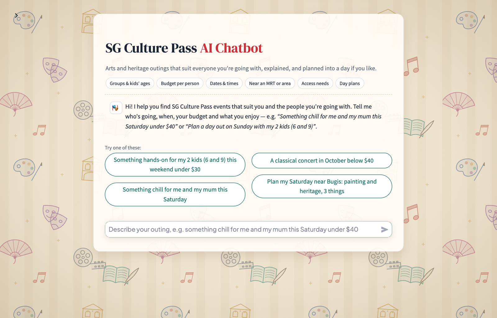
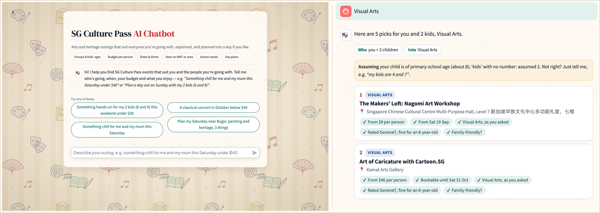
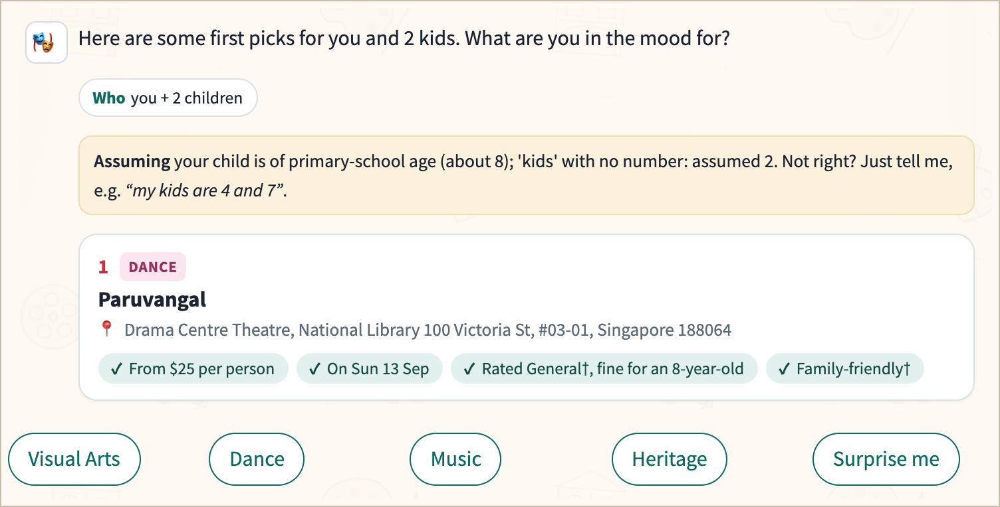
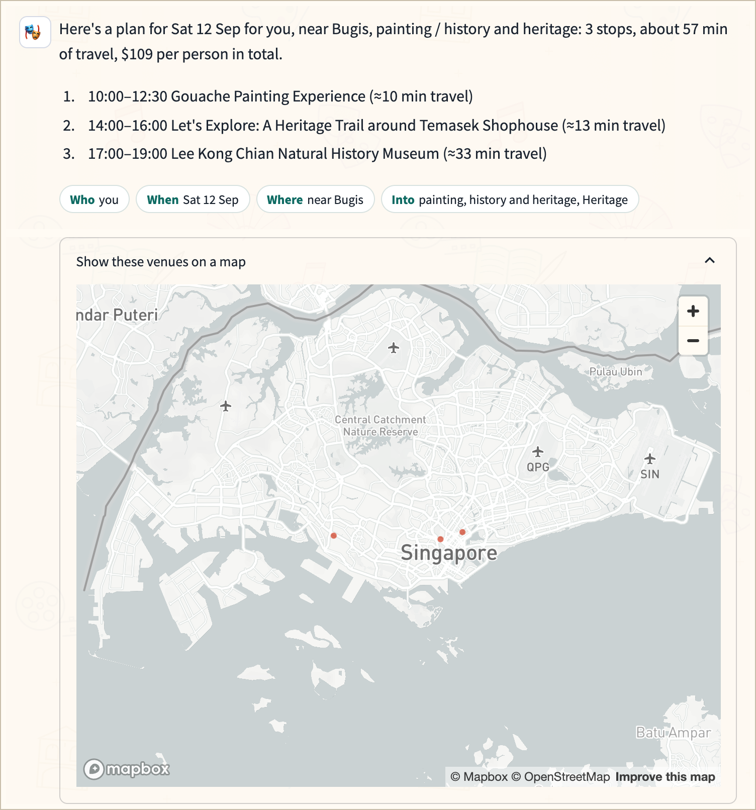
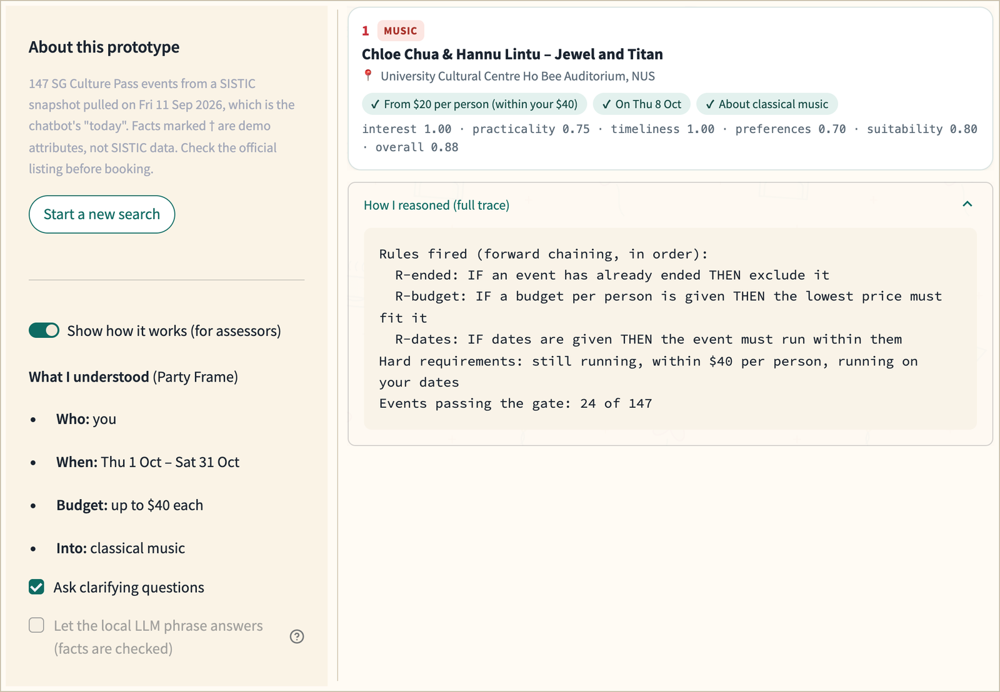
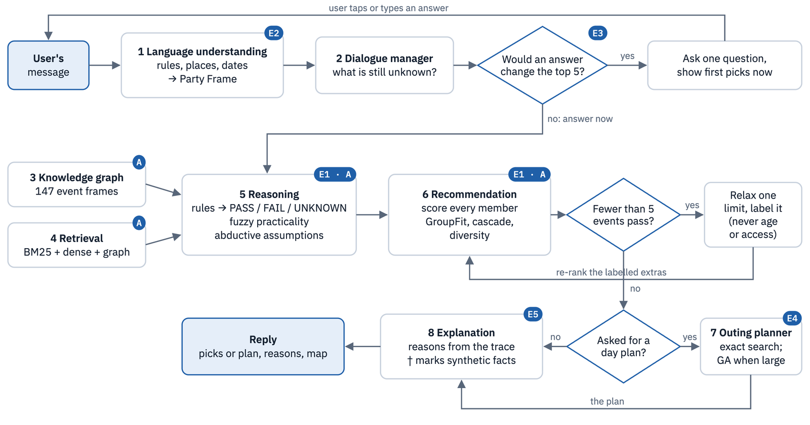
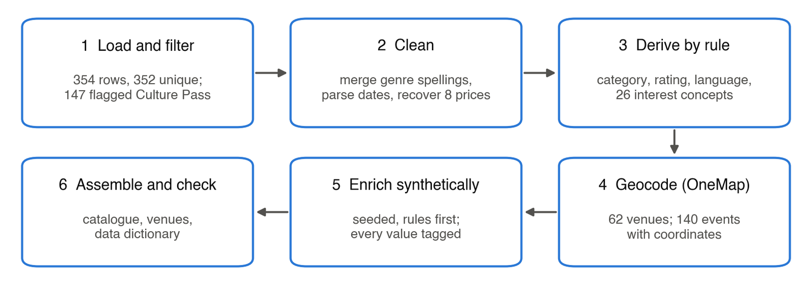
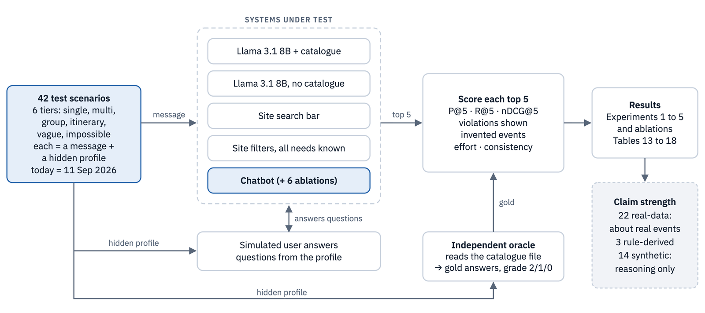
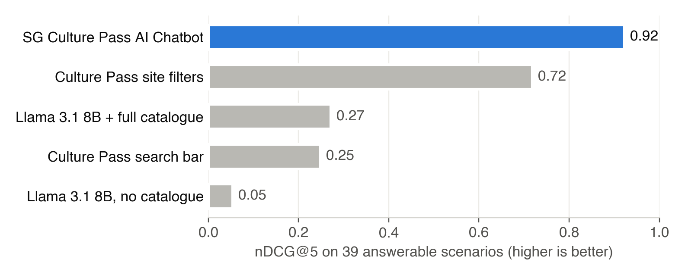
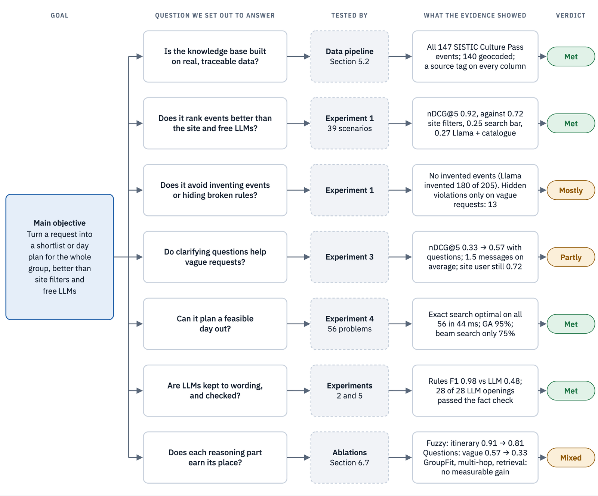

## SECTION 1 : PROJECT TITLE

## SG Culture Pass AI Chatbot: Intelligent Event Recommender & Outing Planner



NUS-ISS Intelligent Reasoning Systems (IRS) Practice Module · Group 4

---

## SECTION 2 : EXECUTIVE SUMMARY

The SG Culture Pass gives every Singapore citizen aged 18 and above S\$100 in credits for local arts and heritage programmes, valid until 31 December 2028. A year after launch, about 1.4 million Singaporeans had registered, but only about 411,000 had used any credits, and about 10% of the S\$300 million set aside had been spent. Two-thirds of registrants had not attended a local arts event in the previous five years. The site lets people find events with fixed filters and a keyword search bar, but neither can take in a request such as *"something hands-on for my two kids this weekend near Tampines, under \$30 each"*, weigh the needs of everyone going, or plan a day out.

The **SG Culture Pass AI Chatbot** is a conversational recommender and outing planner that moves event discovery beyond retrieving listings towards intelligent, group-aware decision support. Rather than leaving users to compare events and reconcile competing needs themselves, it interprets who is going, when, their budget and interests, then evaluates suitability for the whole party. Rule-based language understanding fills a Party Frame, and clarifying questions are asked only when answers could change the advice. Forward-chaining rules check hard constraints, fuzzy logic judges practicality, group-aware scoring ranks candidates, and exact search or a genetic algorithm plans multi-stop outings. Each recommendation is explained from its reasoning trace; optional language-model wording is checked against the facts. The central design proposition is that access to event data alone is not enough: explicit reasoning is needed to turn retrieved information into actionable, constraint-aware recommendations.

The knowledge base holds the 147 Culture Pass events in a SISTIC snapshot pulled on 11 September 2026, geocoded with OneMap and enriched with clearly tagged synthetic attributes where SISTIC has no data. On 39 test scenarios that have a correct answer, the chatbot ranked events better than a diligent user of the site's filters, the site's search bar and Llama 3.1 8B:

| System                                            | nDCG@5         | Invented events | Effort                 |
| ------------------------------------------------- | -------------- | --------------- | ---------------------- |
| **SG Culture Pass AI Chatbot**              | **0.92** | **0**     | **1.5 messages** |
| Culture Pass site filters (user knows every need) | 0.72           | 0               | 5.6 filter clicks      |
| Culture Pass search bar                           | 0.25           | 0               | 1 search               |
| Llama 3.1 8B with the full catalogue              | 0.27           | 4 of 210        | 1 message, about 60 s  |
| Llama 3.1 8B without the catalogue                | 0.05           | 180 of 205      | 1 message, about 15 s  |

The chatbot is weaker on very vague requests, where a site user who already knows every need still does better.

Across these prototype scenarios, the findings support the value of separating retrieval from decision-making: the catalogue supplies candidate events, while explicit rules, scoring and planning assess whether they meet the user's needs. The evidence is strongest for constraint-aware ranking, selective clarification and small-scale itinerary optimisation; the distinctive contribution of GroupFit over simple averaging remains unproven on the current test scenarios. Because the prototype runs on an ordinary CPU without paid AI services, it could be offered at low running cost, and the SISTIC snapshot could be replaced by official Culture Pass data without redesigning the reasoning layers.

---

## SECTION 3 : CREDITS / PROJECT CONTRIBUTION

| Official Full Name                 | Student ID (MTech Applicable) | Work Items (Who Did What)     |
| :--------------------------------- | :---------------------------: | :---------------------------- |
| Abinaya Muruganandam               |           A0181013X           | [to be filled in by the team] |
| Adhithi Muruganandam (Team Leader) |           A0181014W           | [to be filled in by the team] |
| Saranya Srinivasan                 |           A0165428Y           | [to be filled in by the team] |

---

## SECTION 4 : VIDEO OF SYSTEM MODELLING & USE CASE DEMO

- **Business value and use-case demo:** [https://youtu.be/DItA-M33WlA]
- **High-level system design and technical explanation of a use case:** https://youtu.be/OlSb_80QtaU
- **Slides for the system-design video (PDF):** `Video/IRS-PM-2026-10-25-GRP 4-SGCulturePass-AIChatbot-SystemArchitecture-Document.zip`
- **Concept mock-up shown in the demo video:** `Video/Concept Mock-up Slide.pdf` (how the chatbot could appear on the Culture Pass site; not an official feature)

---

## SECTION 5 : USER GUIDE

`Refer to Appendix C, Installation and User Guide, in the project report in the GitHub folder: ProjectReport`

### [ 1 ] Use the public app (nothing to install)

Open **https://sg-culture-pass-chatbot.streamlit.app/** in a browser. The public app runs without the optional local language model, so retrieval uses keyword search and the knowledge graph only, and replies use templates. The rules, constraint checks and planner are the same as on a local copy; a few rankings and questions can differ, but on the test set the overall scores were the same (nDCG@5 0.92).

### [ 2 ] Run it on your own computer

Needs Python 3.12 (3.11 also works).

```bash
cd SystemCode
python3 -m venv .venv
.venv/bin/pip install -r requirements.txt      # about 30 seconds
.venv/bin/streamlit run app/app.py             # opens http://localhost:8501
```

On Windows, use `.venv\Scripts\pip` and `.venv\Scripts\streamlit`. Optional: `.venv/bin/python -m pytest -q` runs the 22 unit tests.

### [ 3 ] Optional: the local language model, for the full system

The chatbot works fully without it. With [Ollama](https://ollama.com) installed, run `ollama pull llama3.1:8b` and `ollama pull nomic-embed-text` (about 5 GB), then `ollama serve`, and start the chatbot as above. This switches on meaning-based retrieval and checked LLM wording (side panel, **Show how it works**, **Let the local LLM phrase answers**), and lets the LLM experiments be re-run. Llama 3.1 8B needs about 8 GB of free memory.

### Using the chatbot

1. **Make a request.** Tap an example or type in the box, in your own words: who is going (with children's ages), when, the budget per person, where, what you enjoy, any access needs, and a language. Or tap a topic under the title, such as **Budget per person** or **Access needs**, and it asks about it with one-tap answers.
2. **Read the reply.** Chips show what the chatbot understood. A gold *Assuming* note shows any guess it made; correct it by just saying so, for example "my kids are 4 and 7". Each card shows the reasons it was chosen; a dagger (†) marks a demo attribute. If too few events fit everything, extra picks say *Close match* and name each limit that was loosened, such as wider dates.
3. **Answer a question.** When an answer would change the picks, it asks one question and shows first picks at the same time. Tap an answer or type your own.
4. **Refine or plan.** Type "under \$25 instead" or "show me more", or tap a topic such as **Budget per person** to change that answer. Ask for several things on one day to get a timed plan with a map.
5. **Start again** with **↺ New search**.



 

**For assessors:** open the side panel (arrow at the top left) and switch on **Show how it works** to see the Party Frame, the experiment switches, the criterion scores on each card and the full reasoning trace.



---

## SECTION 6 : PROJECT REPORT / PAPER

`Refer to the project report in the GitHub folder: ProjectReport`

**Sections of the report:** Executive Summary · Business Case and Market Research · Project Objectives and Success Measures · System Design / Model · System Development & Implementation · Experiments · Findings and Discussion · Conclusion · AI Use Declaration · References · Appendix A: Project Proposal · Appendix B: Mapped System Functionalities against Knowledge, Techniques and Skills of the Modular Courses (MR, RS, CGS) · Appendix C: Installation and User Guide

The rest of this section is a short tour of the report.

### Business case

- **The money is there; choosing is hard.** About a million registered Singaporeans had not used their credits by August 2026, and the scheme now offers more than 1,400 programmes from over 900 partners.
- **The site leaves the reasoning to the user.** Filters cover fixed options only; the search bar returned 165 results for one natural request; groups must be checked member by member; nothing plans a day or explains a pick.
- **Other platforms have assistants; Culture Pass does not.** SISTIC, Klook, Fever and VisitSingapore offer AI help, but none combines the Culture Pass catalogue, reasoning over a whole group, clarifying questions and a reason for every pick.
- **Value and cost.** Free to users on the Culture Pass site; booking stays with the ticketing partners. It needs no paid AI services, runs on an ordinary server and replies in under a second, so it could be commissioned as a one-off build plus yearly maintenance.

### System design: how one request flows through eight layers



| Layer                      | Technique chosen                                                                        | Main alternatives rejected                                         |
| -------------------------- | --------------------------------------------------------------------------------------- | ------------------------------------------------------------------ |
| 1 Language understanding   | Rules, place names and date rules; optional validated LLM                               | Trained NER (no labelled data); LLM alone (F1 0.48, invents slots) |
| 2 Dialogue manager         | Frame-based state tracking; questions chosen by expected value of information; the user can also tap a topic to be asked about it | Never ask; form-filling; an LLM agent                              |
| 3 Knowledge representation | Event frames stored on a knowledge graph; the Party Frame as working memory             | Flat table; OWL ontology; vector store only                        |
| 4 Retrieval                | BM25 + dense embeddings + graph expansion, fused by reciprocal rank fusion              | Keyword only; dense only; HyDE                                     |
| 5 Reasoning                | Forward-chaining rules and a deductive gate; abduction; fuzzy Mamdani practicality      | Bayesian network (no data); case-based reasoning (no cases)        |
| 6 Recommendation           | Multi-criteria scores per member, GroupFit, cascade ranking, diversity, safe relaxation | Collaborative filtering (no history); LLM ranking                  |
| 7 Outing planner           | Exact search while small; genetic algorithm beyond                                      | Beam search (optimal only 75% of the time); LLM as optimiser       |
| 8 Explanation              | Reasons from the reasoning trace; optional LLM wording checked against the facts        | Free LLM text                                                      |

### Data

The knowledge base is built from the 147 events SISTIC flags as Culture Pass, through a six-step pipeline. Every column is tagged as real (SISTIC or OneMap), rule-derived, synthetic or mixed, and results are reported separately for scenarios that depend on synthetic attributes.



### Experiments: how the evaluation was built

42 scenarios in six tiers (single need, several needs, group, itinerary, vague, impossible), each with a first message and a hidden profile of everything the user needs. Correct answers come from an independent oracle that shares no code with the chatbot, and every baseline runs locally, so anyone can re-run the numbers.





| Experiment                                      | Main result                                                                                     |
| ----------------------------------------------- | ----------------------------------------------------------------------------------------------- |
| 1. Chatbot against the site and free LLMs       | nDCG@5 0.92 against 0.72 (site filters) and 0.27 (Llama with the catalogue); no invented events |
| 2. Language understanding by rules, LLM or both | F1: rules 0.98, LLM 0.48, hybrid 0.71                                                           |
| 3. Do clarifying questions help?                | Vague requests rose from 0.33 to 0.57                                                           |
| 4. Outing planner solvers                       | Exact search optimal on all 56 problems in 44 ms; genetic algorithm 95%                         |
| 5. Grounded LLM wording                         | 28 of 28 openings passed the fact check                                                         |

### Findings: did it do what we set out to do?



**What the results cannot claim.** The team wrote the scenarios and the rules; five fixes were made after the first evaluation run and are disclosed; the simulated user never changes their mind; 14 scenarios depend on synthetic attributes; only one small open model was tested (ChatGPT was left out because it cannot be re-run reproducibly); GroupFit's benefit over a simple average is not yet shown; and the chatbot adapts within a conversation but does not yet learn from feedback across users. **Next steps:** a held-out test set written by others, including Singlish; a user study; group scenarios where members disagree; real Culture Pass data, which changes only the first step of the pipeline; and a learning layer that tunes weights and question priors from real usage, such as which topics users tap.

---

## SECTION 7 : MISCELLANEOUS

`Refer to the GitHub folder: Miscellaneous`

- **SystemCode/docs/development_log.md:** the full record of design decisions, problems found and results.
- **SystemCode/EDA_data_cleaning.ipynb:** the data exploration behind every preparation decision.
- **SystemCode/evaluation/results/:** the raw results of every experiment and `summary.md`.
- **Miscellaneous/report_figures/:** the report's charts and app screenshots, and `make_charts.py`, the script that draws the charts.

---

**This project is part of the Graduate Certificate in Intelligent Reasoning Systems (IRS), offered by NUS-ISS.**
